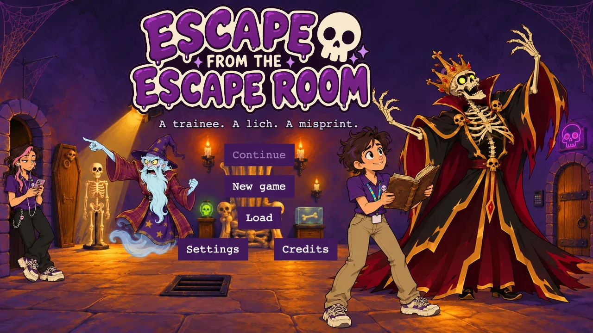
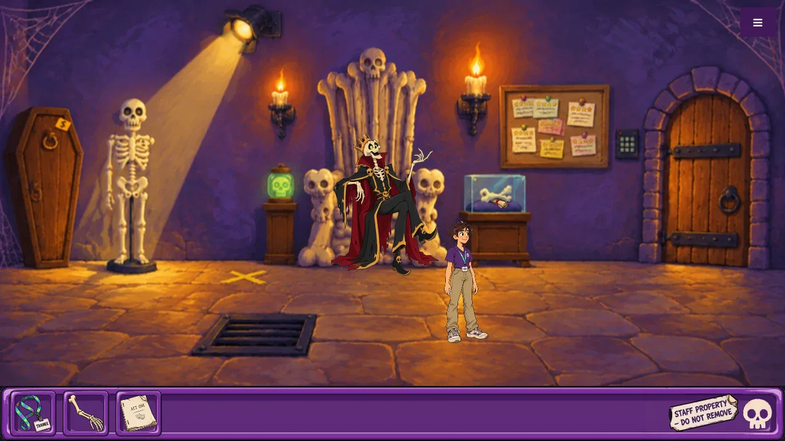

# Escape From the Escape Room

A comedic point-and-click adventure in the spirit of Monkey Island, Day of the Tentacle, and
Detective Grimoire, built in the browser with TypeScript and Phaser 4.

Dana Pickwick, trainee at the Escape-O-Rama franchise, is trapped in the "Lich's Lair" room by a
very real curse, alongside Reginald, a ham actor who is now an actual lich. The only way out is to
beat an escape room that head office designed to be unbeatable.

It's also a learning project: built slice by slice with an AI coding agent, to practise agentic
design and implementation.





## What's in it

- Three painted rooms (the Lich's Lair, the Gift Shop, the Break Room), a full puzzle chain and a
  finale.
- A cast drawn over the paintings: Dana, Reginald (on his throne, on his mark, and human again),
  Kyle at the till and Mordecai floating over the bargain bin.
- A verb coin, an inventory in an Escape-O-Rama tray with an icon for every item, and dialogue trees.
- Music by Kevin MacLeod for the title and each room, sound effects for the story's moments, and
  volume and mute settings.
- Autosave and three save slots, and a game that can always be won (a test explores every reachable
  state to prove it).

## Running it

Play the latest version at https://ratteler50.github.io/escape-from-the-escape-room/
(deployed from `main` on every merge).

To run it locally:

```bash
npm install
npm run dev        # http://localhost:5173
npm test           # unit, content-validation, and architecture tests
npm run typecheck
npm run build
```

## How to play

Click the floor to walk. Click something to open the verb coin (👁 Look, ✋ Take, 💬 Talk, ⚙ Use).
Click an item in the inventory bar and choose "Use with…" to use it on something or combine it with
another item. During conversations, pick Dana's lines from the list; click to skip a line.

Hold **H** (or use the ☰ menu) to see everything you can click; **M** mutes. `?art=off` in the URL
shows the game's placeholder shapes instead of the paintings.

The goal: escape. The curse is very literal about how.

Stuck? Spoiler-light hints, one room at a time:

- **The Lich's Lair:** Reginald won't budge until somebody gives him his cue, and actors keep their
  scripts somewhere close. Something shiny is out of reach; Gary has arms to spare. And read what
  head office printed very, very literally.
- **The Gift Shop:** the ghost wants something done about the bargain bin. Kyle has the right tool,
  and the Employee Handbook has the right section.
- **The Break Room:** a customer can't be on the clock, and a mug costs exactly what it costs. Check
  the fridge, the vending machine, and your own lanyard.

## Where things are

- `docs/README.md`: an index of the docs, saying which are kept current and which are records
- `docs/design.md`: the game as it is, its puzzles and the puzzle dependency chart
- `docs/milestones.md`: how it was planned and built, milestone by milestone
- `docs/slices/`: one spec per slice of work, with notes from building it
- `docs/decisions/`: why things are built the way they are
- `docs/glossary.md`: shared vocabulary; `docs/adding-content.md`: adding rooms, characters, puzzles
- `docs/art/`, `docs/audio/`: how the art was generated and the music picked
- `CREDITS.md`: every asset, its source and its license
- `CLAUDE.md`: conventions for the agent
- `src/core/`: headless game logic (no Phaser), `src/content/`: the game's data,
  `src/view/`: the Phaser layer

## License

The code and docs are MIT licensed ([LICENSE](LICENSE)). The art, music and sound effects are not:
each keeps its own source and license, listed in [CREDITS.md](CREDITS.md) (Kevin MacLeod's music is
CC BY 4.0, Kenney's effects CC0, the art generated for this game). The skills in `.claude/skills/`
are Matt Pocock's, MIT ([.claude/skills/LICENSE](.claude/skills/LICENSE)).
