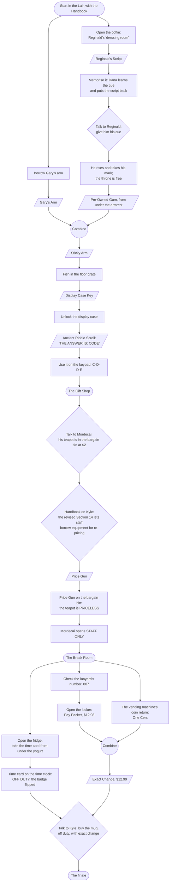

# Escape From the Escape Room — Design

The game as it is now: its premise and cast, its rules, how it's played, and every puzzle. Kept
current: a slice that changes any of this updates it. How the game was planned and built, milestone
by milestone, is in `docs/milestones.md`; why things are built the way they are is in
`docs/decisions/`.

A comedic point-and-click adventure in the LucasArts / Detective Grimoire tradition, built as a
learning project for agentic design and implementation.

## Premise

Dana Pickwick, 19, is on their third weekend shift at **Escape-O-Rama**, a tacky fantasy-themed
escape room franchise. Their lanyard says TRAINEE. They have memorised the Employee Handbook and
nothing useful.

To cut costs, head office bought the room props from a dead wizard's estate sale. One "prop" — the
phylactery on a plinth by the Lich's Lair throne — is real. **Tonight** it woke up and bound the
room's puzzle script with genuine magic: the only way out is to actually **beat the escape room**.
Nobody ever has, because head office designed the puzzles and they are unsolvable as written.

**Escape-O-Rama is otherwise completely mundane.** Before tonight there was no magic anywhere: no
ghosts on the payroll, no curse procedures, nobody trapped. The comedy is ordinary retail life
colliding with one real curse. Content must not imply magic was normal before tonight.

The running theme: **the official solution never works; the improvised one does.**

### Tone

PG, absurdist, wordplay, light fourth-wall poking. Never mean-spirited, never grimdark.

### Cast

- **Dana Pickwick** — protagonist. Earnest, polite to absurdity (including to the undead), quotes
  the Employee Handbook constantly ("Section 4.2: Never touch the guests. It says nothing about
  liches.").
- **Reginald Vantablack-Thorne** — classically trained actor (once understudied a Hamlet) who plays
  the lich for minimum wage. The curse made him a *real* lich, and he regards this as a promotion.
  Refuses to break character, quotes his union contract. Obstacle and reluctant helper.
- **Gary** — a prop skeleton. Reginald considers him a member of the cast.
- **Kyle** — the Gift Shop cashier: a queer nonbinary femme (they/them), third summer at
  Escape-O-Rama, earbuds in, phone out, as few words as possible. "That's not my department." "I
  just work here." Assumes everything tonight (the lich, the ghost, the locked doors) is a new show
  feature head office forgot to mention. Follows till rules to the letter, because thinking is not
  in the job description. The straight man to the curse.
- **Mordecai the Moderately Powerful** — the dead wizard whose estate head office bought. The
  curse woke his ghost tonight; he floats around the Gift Shop, outraged that his possessions are
  "spooky décor" at markdown prices. Can't touch anything, can float through walls. Kyle thinks he's
  a hologram and talks over his monologues.

### The Employee Handbook

Dana quotes it constantly, and carries it (slice 29). Each section means one thing everywhere; check
this list before quoting a section, and add new ones here (`src/content/handbook.test.ts` fails on a
section that isn't listed). It runs to about 400 sections; this list is the ones the game
quotes, and the big numbers are there to say so.

| Section | Rule |
|---------|------|
| 1 | Nobody has ever beaten the escape room (stated like a selling point) |
| 2 | Know your number (your employee number) |
| 3 | Lost property must be returned (and logged) |
| 4.2 | Never touch the guests (says nothing about liches, or skeletons) |
| 5 | No card, no clock |
| 5.3 | Off-duty staff are customers like anyone else |
| 6 | Respect your colleagues' dairy products ("products" so nobody reads "diary") |
| 7.1 | The Spooky Seat is for liches only |
| 8 | Be thorough; found money under five cents belongs to the finder |
| 9 | Doors must never be locked during business hours |
| 10 | Always require exact change (the till never gives change) |
| 11 | Employees may not review their own workplace |
| 12 | Do not improvise with props |
| 13 | Intentionally left blank (head office is superstitious) |
| 14 / 14.1 | Old (memorised by Dana): staff may not borrow equipment from other departments; revised (an insert stapled over it last week): staff may borrow equipment for re-pricing / but not for personal gain |
| 15 | Always contribute |
| 16 | Staff must never be scarier than the attractions |
| 18 | In an emergency, consult the Handbook |
| 19 | All attractions are to be enjoyed in landscape (the sideways screen on an upright phone) |
| 21 | Staff may not name the props (Gary's name tag is stapled to it) |
| 27 | Smile at every guest |
| 33 | Staff must wear a name tag at all times |
| 42 | Do not feed the lich ("the sandwich incident") |
| 57 | Staff must congratulate any guest who solves a puzzle |
| 88 | Staff may not understudy the lich (added by Reginald, in red pen) |
| 113 | Clues may not be written on the staff |
| 150 | Lost guests must be found within one business day |
| 204 | All complaints must be sent in writing to head office (whose address isn't in the Handbook) |
| 276 | The Handbook may only be read on break |
| 311 | Paper cuts from the Handbook are not covered by staff insurance |
| 400 | This Handbook replaces all previous Handbooks (there have been nine) |

Reginald's **actors' union contract** is separate: section nine, the show does not stop until the
final cue; section twelve, wrongful loss of a role.

## Design rules

- **No deaths, no dead ends.** The game is always winnable from any reachable state. Enforced by an
  automated test over every reachable state (`src/content/winnable.test.ts`).
- Every hotspot and item has a funny look line, and every hotspot a line for the Employee Handbook.
  Comedy lives mostly in descriptions and dialogue.
- An item is never lost in a way that blocks progress; one may be taken away only with a line
  saying why.
- Content must not imply magic was normal before tonight (see Premise).

## Interaction

- **Verb coin** (decision 0004): click the floor to walk. Click a hotspot to open a small ring of
  verb icons beside it, showing only the verbs currently available there. Pick one; Dana walks over
  and does it. A hotspot with exactly one available verb skips the coin and does that verb directly.
- **Verbs:** 👁 Look, ✋ Take, 💬 Talk, ⚙ Use. A hotspot may give a verb a joke label ("Borrow a
  limb"); icons stay standard.
- **Items:** click an item in the inventory bar for its coin: Look, "Use with…" (then click a
  hotspot to use it there, or another item to combine them), and its own action if it has one
  (Read, Memorise). Using an item on a target is not a coin verb.
- **Accelerators:** right-click a hotspot or item = Look; hold H to see everything clickable (also a
  ☰ menu toggle); M mutes. Optional, never required.
- **No hidden gestures:** nothing may depend on right-click, hover, or the keyboard alone, so
  trackpads and touchscreens work. Hover labels are a nicety.
- **Visible walking character.** Straight-line movement clamped to a walkable polygon per room.
- **Branching dialogue trees:** conditional options, one-shot options, options that set flags.
- **Screens:** logical resolution 1280×720, scaled to fit. Text grows when the game is shrunk, to
  stay readable (slice 31). On a phone: played sideways, with fingertip-sized touch areas, fullscreen
  where allowed, and an installable home-screen app (slice 32).

## Rooms and puzzles

Three rooms in a line: **the Lich's Lair** ↔ **the Gift Shop** ↔ **the Break Room**. Dana starts in
the Lair with the Employee Handbook. The goal: the escape room's script ends when a guest escapes
**through the gift shop with a souvenir**, so Dana must leave the Lair, become a customer, and buy
the "I ESCAPED THE LICH'S LAIR" mug.

The always-winnable test prints the shortest solution (27 steps, `src/content/winnable.test.ts`);
this chart is what depends on what. Chart a new puzzle here before writing it.

### Puzzle dependency chart

### The Lich's Lair

1. **The cue.** The coffin is Reginald's "dressing room"; inside is his dog-eared script.
   **Memorising** it (an item action) teaches Dana his cue and they return the script, so what
   unlocks the dialogue option is what they *know*, not what they hold. Given the cue, he performs
   "ARISE!" and leaves the throne for his spotlight mark, which lights Gary instead.
2. **The sticky arm.** Gary's arm can be taken at any time (Reginald protests if he sees it). Under
   the vacated throne's armrest: pre-owned gum. Combine arm and gum.
3. **The floor grate.** The display case key fell through the grate. Fish it out with the sticky
   arm (which stays gummed to the grate).
4. **The misprinted riddle.** The display case holds the Ancient Riddle Scroll: *"THE ANSWER IS:
   {CODE}"*, head office's template, never filled in. The curse bound the script exactly as
   printed, so the code is literally **C-O-D-E** on the keypad's phone-style letter keys.

Look-only: the phylactery (whispering, cable-locked to its plinth) and the Customer Reviews board.

### The Gift Shop

1. **Mordecai's favour.** The ghost wants his teapot re-priced properly; in return he'll open any
   door. Re-pricing needs Kyle's price gun, and Section 14 forbids borrowing from other departments,
   until Dana shows Kyle the Handbook and finds the **revised** Section 14 stapled over it. Price
   gun on the bargain bin: PRICELESS. Mordecai floats through STAFF ONLY and opens it.
2. **The false exit.** The front door stands open, but the curse steps Dana back in: the script's
   guest buys a souvenir on the way out.
3. **The mug.** Kyle won't sell to staff ("Lanyard."), and takes only exact change.

### The Break Room

Three puzzles in any order:

1. **Clocking out.** The time card is in the fridge, under a yogurt used as a paperweight. Time card
   on the time clock: OFF DUTY, and Dana flips the badge. Legally a customer.
2. **The locker.** The combination is Dana's employee number, in tiny print on the lanyard (007).
   Inside: the pay packet, $12.98.
3. **The cent.** One cent in the vending machine's coin return. Combined with the pay packet:
   exact change, $12.99.

Reginald is heard here over the intercom, "directing".

### The finale

Off duty, with exact change, Dana buys the mug from Kyle. The script is satisfied and the curse
lifts. Reginald walks in from the Lair, human again, devastated to lose the role of a lifetime, and
files a union grievance. Gary stays one-armed. Reginald drops the phylactery into a box; Kyle prices
it at $1 for the bargain bin; Mordecai is appalled. Last line: the phylactery whispering from the
bargain bin. Then the end card, THE END?

## Technical approach

See `docs/decisions/` for the reasoning behind each choice.

- Browser, **TypeScript (strict) + Phaser 4**, Vite, Vitest, npm.
- **Headless core** (pure TS, no Phaser imports): state, content, rules engine. Fully unit-tested.
- **Phaser view**: renders state, plays animation and text, turns input into core commands.
- **Content as typed TypeScript data modules**, plus a content-validation test (every referenced id
  exists) and an always-winnable test.
