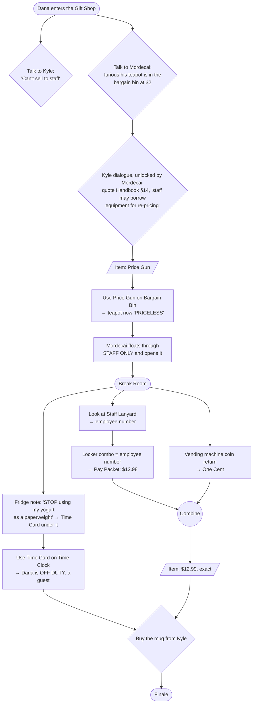

# Escape From the Escape Room — Design Doc

A comedic point-and-click adventure in the LucasArts / Detective Grimoire tradition, built as a
learning project for agentic design and implementation.

## Goals

1. **Primary:** learn to reliably steer an agent to build features the developer understands.
2. **Secondary:** a short, genuinely funny game that is playable start to finish.

The game is the vehicle; scope stays honest because of goal 1.

## Premise

Dana Pickwick, 19, is on their third weekend shift at **Escape-O-Rama**, a tacky fantasy-themed
escape room franchise. Their lanyard says TRAINEE. They have memorised the Employee Handbook and
nothing useful.

To cut costs, head office bought the room props from a dead wizard's estate sale. One "prop" — the
phylactery on a plinth by the Lich's Lair throne — is real. **Tonight** it woke up and bound the
room's puzzle script with genuine magic: the only way out is to actually **beat the escape room**.
Nobody ever has, because head office designed the puzzles and they are unsolvable as written.

**Escape-O-Rama is otherwise completely mundane.** Before tonight there was no magic anywhere: no
ghosts on the payroll, no curse procedures, nobody trapped. The comedy is ordinary retail life
colliding with one real curse. Content must not imply magic was normal before tonight.

The running theme: **the official solution never works; the improvised one does.**

### Tone

PG, absurdist, wordplay, light fourth-wall poking. Never mean-spirited, never grimdark.

### Cast

- **Dana Pickwick** — protagonist. Earnest, polite to absurdity (including to the undead), quotes
  the Employee Handbook constantly ("Section 4.2: Never touch the guests. It says nothing about
  liches.").
- **Reginald Vantablack-Thorne** — classically trained actor (once understudied a Hamlet) who plays
  the lich for minimum wage. The curse made him a *real* lich, and he regards this as a promotion.
  Refuses to break character, quotes his union contract. Obstacle and reluctant helper.
- **Gary** — a prop skeleton. Reginald considers him a member of the cast.
- **Kyle** (M3) — the Gift Shop cashier: a queer nonbinary femme (they/them), third summer at
  Escape-O-Rama, earbuds in, phone out, as few words as possible. "That's not my department." "I
  just work here." Assumes everything tonight (the lich, the ghost, the locked doors) is a new show
  feature head office forgot to mention. Follows till rules to the letter, because thinking is not
  in the job description. The straight man to the curse.
- **Mordecai the Moderately Powerful** (M3) — the dead wizard whose estate head office bought. The
  curse woke his ghost tonight; he floats around the Gift Shop, outraged that his possessions are
  "spooky décor" at markdown prices. Can't touch anything, can float through walls. Kyle thinks he's
  a hologram and talks over his monologues.

### The Employee Handbook

Dana quotes it constantly, and carries it (slice 29). Each section means one thing everywhere; check this list before quoting a
section, and add new ones here.

| Section | Rule |
|---------|------|
| 1 | Nobody has ever beaten the escape room (stated like a selling point) |
| 2 | Know your number (your employee number) |
| 3 | Lost property must be returned (and logged) |
| 4.2 | Never touch the guests (says nothing about liches, or skeletons) |
| 5 | No card, no clock |
| 5.3 | Off-duty staff are customers like anyone else |
| 6 | Respect your colleagues' dairy |
| 7.1 | The Spooky Seat is for liches only |
| 8 | Be thorough; found money under five cents belongs to the finder |
| 9 | Doors must never be locked during business hours |
| 10 | Always offer exact change |
| 11 | Employees may not review their own workplace |
| 12 | Do not improvise with props |
| 13 | Intentionally left blank (head office is superstitious) |
| 14 / 14.1 | Staff may borrow equipment for re-pricing / but not for personal gain |
| 15 | Always contribute |

Reginald's **actors' union contract** is separate: section nine, the show does not stop until the
final cue; section twelve, wrongful loss of a role.

## Design rules

- **No deaths, no dead ends.** The game is always winnable from any reachable state. Enforced by an
  automated test over the puzzle graph.
- Every hotspot has a funny "look" line. Comedy lives mostly in descriptions and dialogue.
- Items used in a puzzle are never lost in a way that blocks progress.

## Interaction

- **Verb coin** (see `docs/decisions/0004-verb-coin.md`): click the floor to walk. Click a hotspot
  to open a small ring of verb icons beside it, showing only the verbs currently available there.
  Pick one; Dana walks over and does it. A hotspot with exactly one available verb skips the coin
  and does that verb directly.
- **Verbs:** 👁 Look, ✋ Take, 💬 Talk, ⚙ Use. A hotspot may give a verb a joke label ("Borrow a
  limb"); icons stay standard.
- **Accelerator:** right-click a hotspot = Look, skipping the coin. Optional, never required.
- **No hidden gestures:** nothing may depend on right-click, hover, or the keyboard alone, so
  trackpads and touchscreens work. Hover labels are a nicety.
- Drag (or select-then-click) an inventory item onto a hotspot to use it on that hotspot, or onto
  another inventory item to combine. Item-on-target is not a coin verb.
- **Visible walking character.** Straight-line movement clamped to a walkable polygon per room.
  Real pathfinding only if a room needs it.
- **Branching dialogue trees:** conditional options, one-shot options, options that set flags.
- Logical resolution **1280×720**, scaled to fit the window.

## Scope and milestones

Three screens: **Lich's Lair**, **Gift Shop**, **Break Room**. A milestone is not started until
the previous one is playable. **M4 is the last milestone:** the project is complete when it ends
(decided 2026-10-23), after slice 28, a text pass and code cleanup, and slice 29, hover polish and the
Handbook as an item (both added 2026-10-23).

| Milestone | Content |
|-----------|---------|
| **M1 — vertical slice** ✅ playable (slices 1–6) | The Lair, fully playable start to finish: walking, hotspots, look text, inventory, one combination, one dialogue tree, a win state ("To be continued"). Ugly but complete. |
| **M2 — systems complete** ✅ (slices 7–12) | Room transitions (with a stub Gift Shop), deploy to GitHub Pages, save/load, cutscenes, browser end-to-end tests, polish. Plan below. |
| **M3 — content** ✅ complete (slices 13–17) | Gift Shop and Break Room, full puzzle chain, ending. Plan below. |
| **M4 — art and audio** (slices 18–29) | Painted backgrounds, character sprites, prop overlays, item icons, music and sound effects, a walk animation; then a text consistency pass and a content-code cleanup, hover polish and the Handbook as an item. No voice. Plan below. |

Art is placeholder shapes until M4, and the code keeps art swappable.

## M4 plan

Decided in the M4 planning session (2026-10-22). Style: decision 0005 (hand-painted cartoon, recipe
"A2" on branch `prototype/lair-art-style`).

**Order.** Prove the whole pipeline on the Lair (art, characters, overlays, audio, item icons:
slices 18–21), so the Lair is polished end to end, then repeat it for the Gift Shop and Break Room in
parallel (22–23), then key art and polish (24). Item icons were added on 2026-10-22: the first plan
left the inventory as text boxes. Slice 21 makes every item's icon at once, from one sheet, and a
styled inventory tray, so the Lair looks finished before the next room starts; the later rooms'
paintings take the icon sheet as a reference so props match their icons.

**Art pipeline.** A layout sketch at exact hotspot coordinates (`docs/art/`) plus a style reference
→ image generation → crop and scale to exact size → WebP in `public/assets/`. The Lair background
was made with Canva (folder "Escape-O-Rama assets"). From slice 19 on, the developer generates in
**ChatGPT** from prompt packs the agent writes (`docs/art/prompts-*.md`), and saves the results to
`art-inbox/` (git-ignored); the agent does everything after that. Canva's free plan allows only 20 AI
generations a month, which M4 can't fit (2026-10-22). The developer approves each image before it's
committed.

**Characters.** Flat colour with hard outlines over the painted rooms. One model sheet per character
(front and three-quarter, approved first), used as the reference for everything after. One standing
pose each, mirrored for direction; walking is a code-driven bounce and lean; a talking pose is a
stretch goal. One exception: **Reginald also gets a seated pose**, lounging on the throne until he
takes his mark (decided 2026-10-22). Sprites come with a transparent
background, or a flat chroma-green one keyed out locally with `ffmpeg`; WebP with alpha.

**Props that change.** Edit the room's background image for each changed state (same scene, one
change), crop the changed region, show it as an overlay by flag. Gary stays painted in, with an
overlay for the missing arm.

**Hotspots over art.** Invisible areas; hover shows the cursor, the name and a soft glow; holding H
or a ☰ menu toggle outlines everything clickable. `?art=off` brings back placeholder rectangles.

**Audio.** Music: CC0 or CC-BY library tracks, shortlisted by the agent (it can't hear), picked by the
developer by ear: a title track, one loop per room, a finale sting. Sound effects: 12–15, CC0 only
(Kenney, Freesound CC0). Music and effects volume plus mute in Settings, saved; music starts on the
title screen's first click; crossfades between rooms.

**Rules.** The game is public on GitHub Pages, so every asset's license must allow public web use.
`CREDITS.md` lists every asset (tool and prompt for generated art); a test checks coverage. Assets
are plain files in the repo with a **15 MB** budget, enforced by a test.

| Slice | Content | Runs |
|-------|---------|------|
| 18 | Art system (room backgrounds, invisible hotspots, glow, show-clickable, `?art=off`); Lair background with the phylactery and a spotlight aimed at Gary; `CREDITS.md`; budget | here |
| 19 | Dana and Reginald model sheets and sprites (Reginald standing and seated); sprite rendering, mirroring, bounce-walk; Lair prop overlays | here |
| 20 | Audio system; Lair music; the sound-effects set | here |
| 21 | Item icons for all 13 items (one sheet); the branded Escape-O-Rama inventory tray; icon on the held item | here |
| 22 | Gift Shop: background (icon sheet attached, so painted props match), Kyle and Mordecai sprites, overlays, music, finale sting | **parallel** with 23 |
| 23 | Break Room: background (icon sheet attached), overlays, music (the finale sting moved to 22: the finale is in the Gift Shop) | **parallel** with 22 |
| 24 | Story fixes: the phone-letter keypad, the {CODE} scroll, the script's last page plants the ending's rule (text only) | after 22 + 23 |
| 25 | The Lair's display case shows its state: lid open, the scroll's end under the bone (two overlays) | after 24 |
| 26 | Title and end-card key art, a painted logo, background music loading, interface to match the tray, a Credits panel | after 25 |
| 27 | Walk animation: prototype a Dana walk cycle two ways (ChatGPT frames, parts animated in code) first; then Reginald and Kyle, or stop and record why | after 26 |
| 28 | Text and structure: content-code cleanup so new rooms, dialogue and puzzles are easier to add (28a); every player-facing line checked for consistency and the jokes finished, no DRAFTs left (28b) | after 27 |
| 29 | Hover polish (label only over props, a fitted glow on characters); the Employee Handbook as an item Dana can read; M4 done | last |

### Notes for later (from play-tests, 2026-10-22)

A record of ideas, not a plan: the project ends with M4 (slice 29, hover polish and the Handbook, is its
last slice), so nothing here is scheduled.

- **The front door's "CLOSED FOR REFURBISHMENT" sign doesn't hold up** (fixed in PR #22: a hanging OPEN/CLOSED sign). It faces into the shop,
  not out, and a closed shop wouldn't have a cashier on duty. Possible fix: a hanging OPEN/CLOSED
  sign showing CLOSED on the inside, because that's the side staff see while the shop is open. It
  explains the cashier, and Dana can be pedantic about it.
- **Dialogue still says the doors won't open** (fixed in PR #22). Kyle's option "the lich is real and the doors won't
  open" (`kyle.ts`) no longer fits a front door that stands open: the point is that Dana *can't
  leave* (the curse sends them back). Reword it, and check other lines for the same assumption.
- **A walk animation** for Dana (and Reginald and Kyle when they walk), instead of the code-driven
  hop and lean: scheduled as slice 27, prototype first (image generators drift between frames).
- **The phylactery in the bargain bin** for the finale's last shot (from slice 22's spec).

## M3 plan

Decided in the M3 planning session (2026-10-21).

**Goal: exit through the gift shop.** The escape room's script ends when a **guest** escapes and
buys a souvenir. Dana must buy the "I ESCAPED THE LICH'S LAIR" mug ($12.99), but they're **staff**:
Kyle won't sell merchandise to anyone wearing a lanyard. They have to clock out to legally become a
customer, and find the money. The front door is a false exit: "EXIT THROUGH THE GIFT SHOP. I haven't
bought anything. The curse is very literal."

**Rooms.** Lair ↔ Gift Shop ↔ Break Room, in a line. The Break Room is behind a STAFF ONLY door that
a trainee badge doesn't open. No new character in the Break Room: object puzzles plus office comedy
(fridge notes, lockers, vending machine), with Reginald heard over the intercom.

**Reginald** stays in the Lair during M3, heard on the intercom, and walks into the Gift Shop for
the finale (cutscene system). **Dialogue:** regular trees for Kyle and Mordecai; no mini-game.

### M3 puzzle dependency chart

Four puzzles: Mordecai's favour (via Kyle's price gun) opens STAFF ONLY; the time card and clocking
out; lanyard → locker → pay packet; the cent for exact change. The Break Room's three branches run
in parallel.

### Finale

Buying the mug satisfies the script and the curse lifts. Reginald walks in from the Lair and turns
back into a human actor: devastated to lose the role of a lifetime, he announces a union grievance.
Gary stays one-armed. Reginald knocks the phylactery into a box; Kyle prices it at $1 for the
bargain bin; Mordecai is appalled. Last shot: the phylactery whispering from the bargain bin.

### Art readiness

Each new room gets a layout reference sketch at its exact hotspot coordinates, with clear
silhouettes and empty wall space, ready for the art recipe in decision 0005.

| Slice | Content | Runs |
|-------|---------|------|
| 13 | This plan, decision 0005 (art style), premise fixes, the phylactery in the Lair | here |
| 14 | Gift Shop: Kyle, Mordecai, price gun, bargain bin, STAFF ONLY opens (no way through yet) | **parallel** with 15 |
| 15 | Break Room: fridge, time clock, lockers, vending machine, Reginald's intercom | **parallel** with 14 |
| 16 | Room-to-room wiring (STAFF ONLY ↔ Break Room), the front-door false exit, buying the mug, and the finale cutscene | after 14 + 15 |
| 17 | Polish, plus the always-winnable test over the whole game | last |

Slices 14 and 15 own separate room files; both touch `world.ts` to register content, a small merge.

## M2 plan

Decided in the M2 planning session (2026-10-21).

**Rooms.** Inventory, flags, and conversation history are global. Moving rooms is a `goToRoom
{ roomId, entry }` effect; each room has named entry points. Exits are hotspots with ⚙ "Go through".
An exit may take an item away, but only with a line explaining why (the always-winnable test guards
it). M2 adds a **stub Gift Shop**: placeholder screen, a few look-only hotspots, the door back to the
Lair, and a "CLOSED FOR REFURBISHMENT" front door that now carries the "To be continued…" win.

**Save/load.** Autosave whenever the game is at rest, plus **3 manual slots**. A ☰ menu button
(Save, Load, Settings, Quit to title); a title screen (Continue, New game, Load). Saving is allowed
whenever nothing is playing, including mid-conversation. Saves carry a format version and are
validated against current content on load; incompatible saves show a message instead of crashing.

**Cutscenes.** More effect types played by the existing speech queue: `walk`, `pause`, `face`. They
are presentation only: the core passes them through, game state stays flag-based. Reginald walks to
his mark; Dana walks out through exits. A parallel-actions effect can be added later if needed.

**Deploy.** GitHub Pages from the private repo: the game is public at a URL, the code isn't.

**Browser tests.** Playwright against the production build: one full play-through following the
always-winnable test's shortest solution with real clicks, no console errors on load, and a save
round-trip. The dev hook is enabled in production by a `?e2e` URL flag.

**Polish.** Hover-label overlap fixes, text speed setting, hotspot highlight on hover, skip a whole
sequence, speaker name tags, cursor feedback over exits vs. things, and a **typewriter effect** for
lines (letters appear one by one at the text speed; the first click completes the line, the next
advances), so the text speed setting is visible rather than only changing auto-advance timing.

| Slice | Content | Runs |
|-------|---------|------|
| 7 | Rooms + stub Gift Shop; split `RoomScene` into smaller components | Phase A, here |
| 8 | Deploy to GitHub Pages | Phase A, **parallel session** |
| 9 | Save/load, title screen, ☰ menu, text speed setting | Phase B |
| 10 | Cutscenes + skip a whole sequence | Phase C, here |
| 11 | Playwright end-to-end tests in CI | Phase C, **parallel session** |
| 12 | Polish: hover labels, highlight, name tags, cursor, typewriter text | Phase D |

## M1: the Lich's Lair

**Goal:** open the Lair door to the Gift Shop. The door has a keypad (eight phone-style letter keys
and ENTER, since slice 24); head office's official riddle is supposed to provide the code.

### Puzzle dependency chart

### Puzzles

1. **The cue line.** The coffin is Reginald's "dressing room"; inside is his dog-eared script.
   **Memorising** it (an item action) teaches Dana the cue and they return the script, so what
   unlocks the dialogue option is what they *know*, not what they hold. Feeding him the cue: he
   performs "ARISE!" and leaves the throne for his spotlight mark. If they talk to him holding the
   unread script, they muse that they'd need the cue by heart.
2. **The sticky arm.** Gary's arm can be taken at any time (Reginald protests if he sees it). Under
   the vacated throne: pre-owned chewing gum. Combine arm + gum.
3. **The floor grate.** The display case key fell through the grate. Fish it out with the sticky arm.
4. **The misprinted riddle.** The display case holds the Ancient Riddle Scroll, which reads
   *"THE ANSWER IS: {CODE}"*: head office's template, never filled in. The curse bound itself to
   the script *as printed*, so the code is literally **C-O-D-E** (slice 24; it used to read
   "[INSERT CODE HERE BEFORE PRINTING]"). Use the scroll on the keypad; the door opens.
   Showing the scroll to Reginald gets an outraged-on-behalf-of-the-craft reaction line.

### Reginald's dialogue tree

Four to six options: who are you; what's going on; can you let me out (he won't break character);
Handbook Section 4.2; plus the cue line, available only after reading the script. Some options are
one-shot, others repeatable.

### Look-only hotspots (hooks for later)

The phylactery (whispers; bolted down with corporate anti-theft cable; added in slice 13), the
intercom "hint button", the fog machine, the Customer Reviews board.

## Technical approach

See `docs/decisions/` for the reasoning behind each choice.

- Browser, **TypeScript (strict) + Phaser 4**, Vite, Vitest, npm.
- **Headless core** (pure TS, no Phaser imports): state, content, rules engine. Fully unit-tested.
- **Phaser view**: renders state, plays animation and text, turns input into core commands.
- **Content as typed TypeScript data modules**, plus a content-validation test (every referenced id
  exists) and an always-winnable test.
