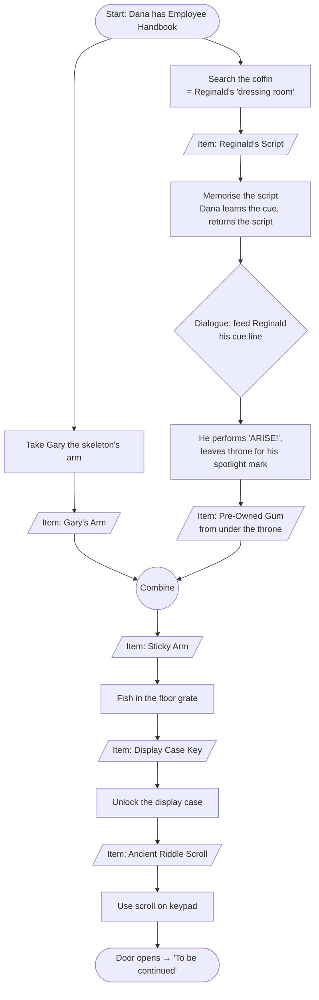

# Escape From the Escape Room — Design Doc

A comedic point-and-click adventure in the LucasArts / Detective Grimoire tradition, built as a
learning project for agentic design and implementation.

## Goals

1. **Primary:** learn to reliably steer an agent to build features the developer understands.
2. **Secondary:** a short, genuinely funny game that is playable start to finish.

The game is the vehicle; scope stays honest because of goal 1.

## Premise

Dana Pickwick, 19, is on their third weekend shift at **Escape-O-Rama**, a tacky fantasy-themed
escape room franchise. Their lanyard says TRAINEE. They have memorised the Employee Handbook and
nothing useful.

To cut costs, head office bought the room props from a dead wizard's estate sale. One "prop" — the
phylactery on the Lich's Lair altar — is real. It has bound the room's puzzle script with genuine
magic: the only way out is to actually **beat the escape room**. Nobody ever has, because head
office designed the puzzles and they are unsolvable as written.

The running theme: **the official solution never works; the improvised one does.**

### Tone

PG, absurdist, wordplay, light fourth-wall poking. Never mean-spirited, never grimdark.

### Cast (M1)

- **Dana Pickwick** — protagonist. Earnest, polite to absurdity (including to the undead), quotes
  the Employee Handbook constantly ("Section 4.2: Never touch the guests. It says nothing about
  liches.").
- **Reginald Vantablack-Thorne** — classically trained actor (once understudied a Hamlet) who plays
  the lich for minimum wage. The curse made him a *real* lich, and he regards this as a promotion.
  Refuses to break character, quotes his union contract. Obstacle and reluctant helper.
- **Gary** — a prop skeleton. Reginald considers him a member of the cast.

Gift Shop and Break Room casts are designed at the start of M3.

## Design rules

- **No deaths, no dead ends.** The game is always winnable from any reachable state. Enforced by an
  automated test over the puzzle graph.
- Every hotspot has a funny "look" line. Comedy lives mostly in descriptions and dialogue.
- Items used in a puzzle are never lost in a way that blocks progress.

## Interaction

- **Verb coin** (see `docs/decisions/0004-verb-coin.md`): click the floor to walk. Click a hotspot
  to open a small ring of verb icons beside it, showing only the verbs currently available there.
  Pick one; Dana walks over and does it. A hotspot with exactly one available verb skips the coin
  and does that verb directly.
- **Verbs:** 👁 Look, ✋ Take, 💬 Talk, ⚙ Use. A hotspot may give a verb a joke label ("Borrow a
  limb"); icons stay standard.
- **Accelerator:** right-click a hotspot = Look, skipping the coin. Optional, never required.
- **No hidden gestures:** nothing may depend on right-click, hover, or the keyboard alone, so
  trackpads and touchscreens work. Hover labels are a nicety.
- Drag (or select-then-click) an inventory item onto a hotspot to use it on that hotspot, or onto
  another inventory item to combine. Item-on-target is not a coin verb.
- **Visible walking character.** Straight-line movement clamped to a walkable polygon per room.
  Real pathfinding only if a room needs it.
- **Branching dialogue trees:** conditional options, one-shot options, options that set flags.
- Logical resolution **1280×720**, scaled to fit the window.

## Scope and milestones

Three screens: **Lich's Lair**, **Gift Shop**, **Break Room**. A milestone is not started until
the previous one is playable.

| Milestone | Content |
|-----------|---------|
| **M1 — vertical slice** ✅ playable (slices 1–6) | The Lair, fully playable start to finish: walking, hotspots, look text, inventory, one combination, one dialogue tree, a win state ("To be continued"). Ugly but complete. |
| **M2 — systems complete** | Room transitions (with a stub Gift Shop), deploy to GitHub Pages, save/load, cutscenes, browser end-to-end tests, polish. Plan below. |
| **M3 — content** | Gift Shop and Break Room, full puzzle chain, ending. |
| **M4 — optional polish** | Art pass (vector or AI-generated), SFX, a music loop. No voice. |

Art is placeholder shapes until M4, and the code keeps art swappable.

## M2 plan

Decided in the M2 planning session (2026-10-21).

**Rooms.** Inventory, flags, and conversation history are global. Moving rooms is a `goToRoom
{ roomId, entry }` effect; each room has named entry points. Exits are hotspots with ⚙ "Go through".
An exit may take an item away, but only with a line explaining why (the always-winnable test guards
it). M2 adds a **stub Gift Shop**: placeholder screen, a few look-only hotspots, the door back to the
Lair, and a "CLOSED FOR REFURBISHMENT" front door that now carries the "To be continued…" win.

**Save/load.** Autosave whenever the game is at rest, plus **3 manual slots**. A ☰ menu button
(Save, Load, Settings, Quit to title); a title screen (Continue, New game, Load). Saving is allowed
whenever nothing is playing, including mid-conversation. Saves carry a format version and are
validated against current content on load; incompatible saves show a message instead of crashing.

**Cutscenes.** More effect types played by the existing speech queue: `walk`, `pause`, `face`. They
are presentation only: the core passes them through, game state stays flag-based. Reginald walks to
his mark; Dana walks out through exits. A parallel-actions effect can be added later if needed.

**Deploy.** GitHub Pages from the private repo: the game is public at a URL, the code isn't.

**Browser tests.** Playwright against the production build: one full play-through following the
always-winnable test's shortest solution with real clicks, no console errors on load, and a save
round-trip. The dev hook is enabled in production by a `?e2e` URL flag.

**Polish.** Hover-label overlap fixes, text speed setting, hotspot highlight on hover, skip a whole
sequence, speaker name tags, cursor feedback over exits vs. things.

| Slice | Content | Runs |
|-------|---------|------|
| 7 | Rooms + stub Gift Shop; split `RoomScene` into smaller components | Phase A, here |
| 8 | Deploy to GitHub Pages | Phase A, **parallel session** |
| 9 | Save/load, title screen, ☰ menu, text speed setting | Phase B |
| 10 | Cutscenes + skip a whole sequence | Phase C, here |
| 11 | Playwright end-to-end tests in CI | Phase C, **parallel session** |
| 12 | Polish: hover labels, highlight, name tags, cursor | Phase D |

## M1: the Lich's Lair

**Goal:** open the Lair door to the Gift Shop. The door has a rune keypad; head office's official
riddle is supposed to provide the code.

### Puzzle dependency chart

### Puzzles

1. **The cue line.** The coffin is Reginald's "dressing room"; inside is his dog-eared script.
   **Memorising** it (an item action) teaches Dana the cue and she returns the script, so what
   unlocks the dialogue option is what she *knows*, not what she holds. Feeding him the cue: he
   performs "ARISE!" and leaves the throne for his spotlight mark. If she talks to him holding the
   unread script, she muses that she'd need the cue by heart.
2. **The sticky arm.** Gary's arm can be taken at any time (Reginald protests if he sees it). Under
   the vacated throne: pre-owned chewing gum. Combine arm + gum.
3. **The floor grate.** The display case key fell through the grate. Fish it out with the sticky arm.
4. **The misprinted riddle.** The display case holds the Ancient Riddle Scroll, which reads
   *"THE ANSWER IS: [INSERT CODE HERE BEFORE PRINTING]"*. The curse bound itself to the script
   *as printed*, so the code is literally **C-O-D-E**. Use the scroll on the keypad; the door opens.
   Showing the scroll to Reginald gets an outraged-on-behalf-of-the-craft reaction line.

### Reginald's dialogue tree

Four to six options: who are you; what's going on; can you let me out (he won't break character);
Handbook Section 4.2; plus the cue line, available only after reading the script. Some options are
one-shot, others repeatable.

### Look-only hotspots (hooks for later)

The phylactery (whispers; bolted down with corporate anti-theft cable), the intercom "hint button",
the fog machine, the Customer Reviews board.

## Technical approach

See `docs/decisions/` for the reasoning behind each choice.

- Browser, **TypeScript (strict) + Phaser 4**, Vite, Vitest, npm.
- **Headless core** (pure TS, no Phaser imports): state, content, rules engine. Fully unit-tested.
- **Phaser view**: renders state, plays animation and text, turns input into core commands.
- **Content as typed TypeScript data modules**, plus a content-validation test (every referenced id
  exists) and an always-winnable test.
