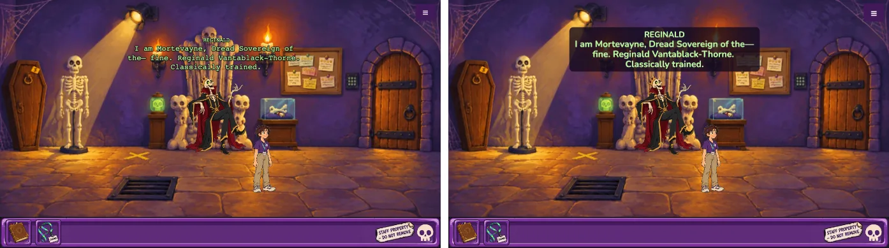

# Slice 31 — Readability: one font, speech bands, text that grows

**Status:** built, awaiting developer play-test · **Milestone:** M5 (first slice)

## Why

The text is the one part of the game that hasn't been designed. Everything uses Phaser's default
font, Courier, which is thin and breaks up when the game is shrunk; speech is coloured text with a
black outline straight over the paintings, which gets muddy; and because the game is drawn at
1280×720 and scaled to fit, a phone held sideways shows the 22 px speech at about 12 px. This slice
fixes all three for every screen, desktop included, and prepares the ground for slice 32 (mobile).
Decisions from the M5 planning session (2026-10-24), in `docs/design.md`, M5 plan.

## Spec

1. **Nunito, everywhere.** Bold (700) for all text, black (900) for headings (menu and panel titles,
   THE END?, the loading screen's ESCAPE-O-RAMA). Bundled as WOFF2 files in `public/assets/fonts/`
   under the SIL Open Font License (the license text alongside), loaded before anything is drawn
   (Phaser draws text to a canvas, so a font that arrives late would leave the first screens in the
   fallback), and credited in `CREDITS.md`. One shared text style in the view, so no text object
   names its own font. `?art=off` uses it too.
2. **Speech on bands.** Each spoken line is drawn on a dark, slightly see-through band with rounded
   corners, over the speaker's head as now. The speaker's name sits on the band in their colour;
   the line keeps their colour (Dana's too). The band is sized to its text, and lines are wrapped
   so they don't end on a single short word. The outline goes (the band does its job). The typewriter
   effect and click-to-skip work as before; the band doesn't jump size while a line types out.
3. **Text grows when the game is shrunk.** From the game's on-screen scale, text that would show
   smaller than **14 px** (12 px for small labels: speaker names, the inventory's text fallback)
   is drawn bigger to keep that size. At laptop size (scale about 1) nothing changes. It applies to
   speech, dialogue options, the hover caption, the verb coin's labels, menus and the Credits panel,
   and is re-applied if the window is resized. Consequences handled: speech bands get taller (and
   stay on screen); the dialogue options panel grows and **scrolls** (drag, wheel, or arrows) when
   its options don't fit; menus that would overflow get taller or wrap.
4. **Comic beats.** A spoken line may contain a deliberate line break (`\n`), kept whatever the
   font or size. A pass over all dialogue adds breaks at interruptions ("of the—" / "fine.") and
   before punchlines where a beat helps; each added break is marked so the drafts list shows it,
   for the developer to keep or remove.
5. **Records.** `CREDITS.md` (the font), the M5 plan in `docs/design.md` (done with this spec), and
   build notes with before/after screenshots at laptop and phone size.

Out of scope (slice 32): the portrait "turn your phone sideways" screen, touch areas, fullscreen
and home-screen support, the phone-sized Playwright run.

## Approvals you'll be asked for

1. Screenshots at laptop size and at phone size (a 0.54× view) of speech, dialogue options, a menu,
   the verb coin and the end card.
2. The comic-beat line breaks (in the drafts list).
3. Developer play-test.

## Acceptance checks

- `npm test`, typecheck, build, Playwright green. The harness finds buttons and options by their
  text, which doesn't change; update `e2e/game.ts` if the dialogue panel's structure does.
- Unit tests: the text-size rule (scale in, font size out: unchanged at 1×, at least 14 px on screen
  below), and that line breaks in content survive.
- The font is loaded before the title screen draws (no Courier flash; checked in the browser).
- Agent play-test (headless screenshots) at 1280×720 and at a phone-sized landscape viewport:
  speech for every speaker colour over the busiest parts of each painting, a long line, a
  conversation with many options scrolling, menus, `?art=off`.
- Developer play-test.

## Notes

- Branch `m5-readability`, from `main` (the M5 plan and this spec), then the build.

## Build notes (2026-10-23)

- **Font.** `public/assets/fonts/nunito-latin.woff2` (Nunito's variable font, Latin subset, 38 KB,
  weights 200–1000 in one file) and `OFL.txt`. `index.html` declares it with `@font-face`;
  `main.ts` waits for `document.fonts.load` of bold and black before creating the game (and starts
  anyway in the fallback if that fails). One style helper, `font(scene, px, { heading, min })` in
  `src/view/ui.ts`, gives every text object its family, weight and size; no view file names a font
  any more. The verb coin's emoji icons keep a plain size.
- **The size rule** lives in `src/view/textSize.ts`: `readableSize(design, onScreen, min)` returns
  the design size, or the size that shows `min` px on screen if that's bigger (22 px speech becomes
  26 px at a phone's 0.54×). `onScreenScale` reads Phaser's scale manager. Unit-tested.
- **Speech** (`Speech.ts`) is now one text object per wrapped line on a rounded band
  (`0x140a1e`, 80 %), with the name above the line in the speaker's colour. One object per line
  because Nunito isn't monospaced: the old trick of padding the unrevealed part with spaces would
  make the line wobble as it types out. The band is sized to the whole line before typing starts,
  so it doesn't jump. `balancedWidth` narrows the wrap until the last line has two or more words,
  keeping deliberate breaks.
- **Resizing.** The room's hover caption re-sizes itself on a resize; speech, options, the coin and
  menus are made fresh each time they open, so they pick up the new size anyway. The title screen
  restarts itself on a resize (its buttons and their layout are made in `create`).
- **Dialogue options** (`DialoguePanel.ts`) never cover more than 45 % of the screen; past that the
  list scrolls by the mouse wheel or the ▲/▼ arrows at its right. Dragging to scroll is left for
  slice 32 (touch). Rows grow with the text (at least 40 px).
- **Credits** is sized to its text and wraps wider when the text has grown: at phone size its Back
  button covered the last line (found in the agent play-test).
- **Comic beats.** Seven lines in `reginald.ts` and `breakRoom.ts` got a `\n`, each marked
  `// DRAFT:`. `docs/drafts.md` shows the break as ⏎ (`scripts/drafts.ts`).

Agent play-test (headless Chromium, 1280×720 and 691×389, which is the 0.54× of a phone held
sideways): the font is in place on the first frame of the loading screen at both sizes; speech for
Reginald (green, `?art=off` too), Kyle (pink), Mordecai (pale blue) and Dana (yellow) over the busiest
parts of the Lair, Gift Shop and Break Room; a long line with the comic beat; Reginald's options;
nine options scrolling by the wheel; the ☰ menu, Credits, the verb coin and the end card. No console
errors. `npm test` (517), typecheck, build and Playwright green.

